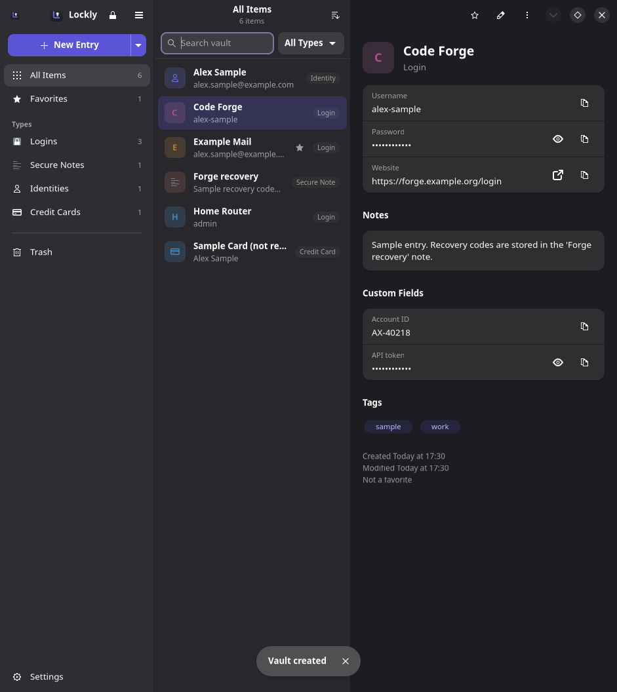
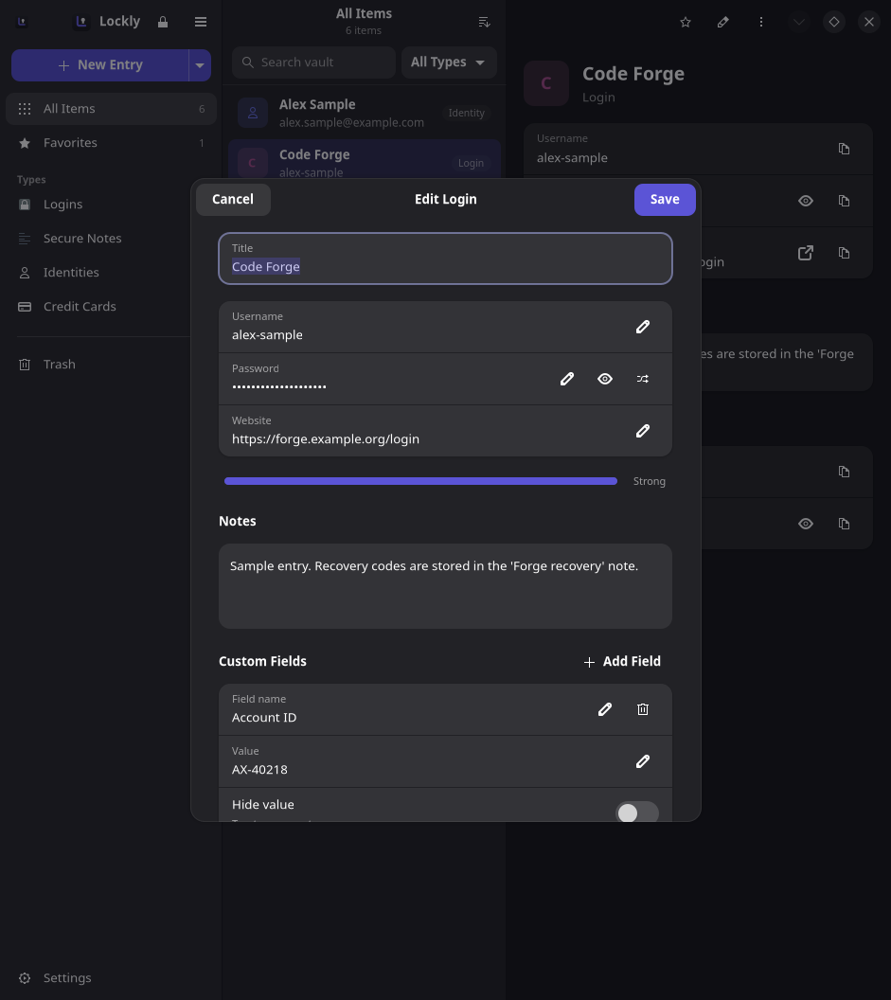
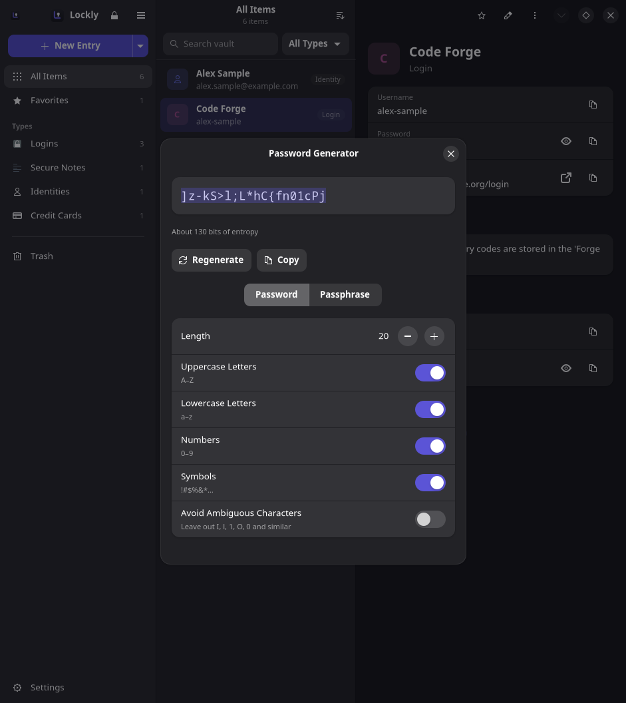
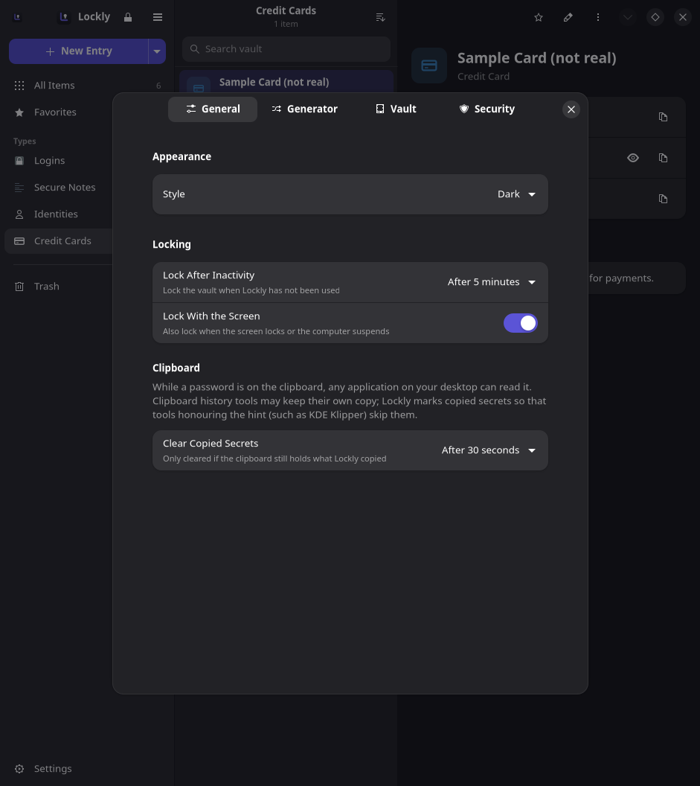
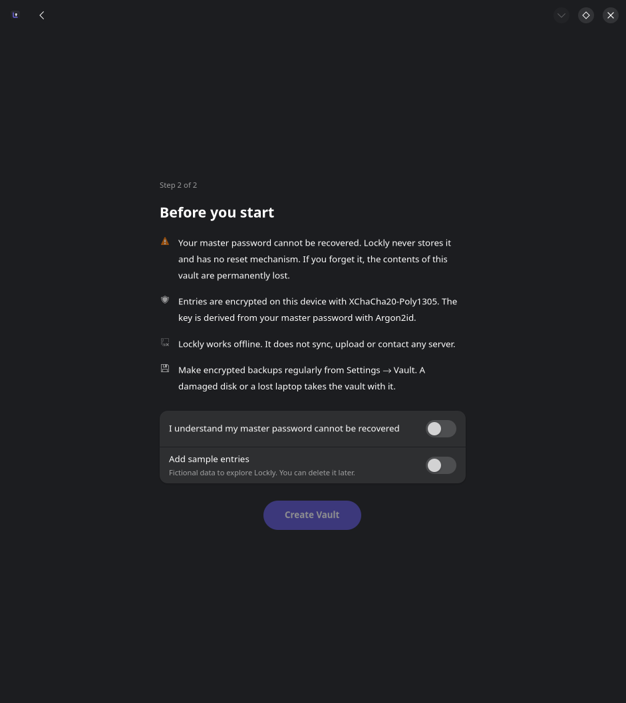
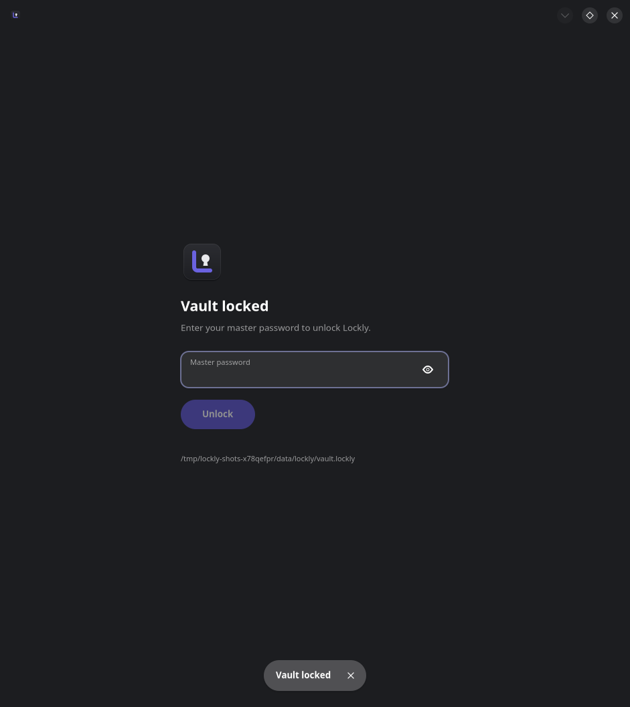

# Lockly

**Your passwords. Your privacy.**

Lockly is a local-first password manager for the Linux desktop, built with
GTK 4 and libadwaita. It keeps logins, secure notes, identities and payment
cards in an encrypted vault on your computer. It does not sync, upload or
contact any server.

> **Status: early release (0.1.0).** The vault format and cryptography are
> documented and tested, but Lockly has **not** had an independent security
> audit. Keep encrypted backups.

## Features

Implemented:

* **Encrypted vault.** Argon2id key derivation (256 MiB by default, 1 GiB
  optional) and XChaCha20-Poly1305 authenticated encryption via libsodium. All
  entry data, including titles and tags, is encrypted. See
  [docs/SECURITY.md](docs/SECURITY.md).
* **Entry types.** Logins (with custom fields), secure notes, identities and
  credit cards.
* **Full entry management.** Create, edit, favourite, move to Trash, restore
  and delete permanently, with Undo after moving an entry to the Trash.
* **Fast in-memory search** across titles, usernames, websites, types, tags,
  notes and visible custom fields. Secret values are never indexed.
* **Sorting** by name, date created or recently modified, plus filters by
  category and by type.
* **Password generator.** Random passwords (length, character sets, avoid
  ambiguous characters) and EFF-wordlist passphrases, using the OS CSPRNG.
* **Clipboard protection.** Copied secrets are cleared after a configurable
  delay, but only if the clipboard still holds them. They are also marked so
  that clipboard managers can skip them.
* **Locking.** Manual (Ctrl+L), after inactivity, when the screen locks,
  before suspend, and always at start-up.
* **Encrypted backups** with their own password. Imports are validated before
  anything is merged.
* **Plaintext CSV export**, which needs an explicit warning, confirmation and
  the master password.
* **First-run setup** with a strength meter and a clear warning that the
  master password cannot be recovered; also restore-from-backup.
* **Adaptive layout** from a wide three-pane window down to phone-sized widths.
* **Keyboard driven**, with accessible labels on every control.
* **Dark, light or system** appearance.

Planned (not implemented): see the [Roadmap](#roadmap).

## Screenshots

| | |
| --- | --- |
|  |  |
|  |  |
|  |  |

All data shown is fictional sample content. To regenerate the images from a
throw-away vault, run `python tools/screenshots.py docs/screenshots`.

## Supported platforms

Linux with:

| Component | Minimum |
| --- | --- |
| Python | 3.11 |
| GTK | 4.14 |
| libadwaita | 1.6 |
| PyGObject | 3.48 |
| PyNaCl | 1.5 |

Known to satisfy these: Arch Linux, Fedora 41+, Debian 13 (trixie),
Ubuntu 24.10+. Debian 12 and Ubuntu 24.04 ship libadwaita versions that are
too old.

Windows and macOS are not supported yet. The core (`lockly.core`) has no GTK
dependency, so other front ends are possible.

## Installation

### Quick install

Install the system libraries for your distribution (below), then run:

```sh
curl -fsSL https://raw.githubusercontent.com/gerchanisko/lockly/main/install.sh | sh
```

This installs Lockly for your user only, into `~/.local` (no root needed), and
adds it to your app menu. Run the same command again to update. To remove
Lockly, run the same command with `| sh -s -- --uninstall` at the end instead
of `| sh`; your vault is kept.

Prefer to read the script first? Download it, check it, then run
`sh install.sh`.

### 1. System dependencies

**Fedora**

```sh
sudo dnf install python3 python3-gobject gtk4 libadwaita python3-pynacl
```

**Arch Linux**

```sh
sudo pacman -S python python-gobject gtk4 libadwaita python-pynacl
```

**Debian / Ubuntu**

```sh
sudo apt install python3 python3-gi gir1.2-gtk-4.0 gir1.2-adw-1 python3-nacl python3-venv
```

### 2. Run from a checkout (no installation)

```sh
git clone https://github.com/gerchanisko/lockly.git && cd lockly
PYTHONPATH=src python3 -m lockly
```

### 3. Install for your user

```sh
python3 -m venv --system-site-packages ~/.local/share/lockly-venv
~/.local/share/lockly-venv/bin/pip install .
ln -s ~/.local/share/lockly-venv/bin/lockly ~/.local/bin/lockly
./tools/install-desktop-entry.sh     # launcher + icon in ~/.local/share
```

`--system-site-packages` lets the virtual environment use your
distribution's PyGObject/GTK. No root privileges are needed, and the vault
always lives in your home directory.

Distribution packaging templates (PKGBUILD, RPM spec, Debian) are in
[packaging/](packaging/).

## Usage

On first launch Lockly asks you to create a vault, or restore one from a
backup. The vault is stored at `~/.local/share/lockly/vault.lockly`. Set
`LOCKLY_VAULT=/path/to/file` to use a different file.

| Shortcut | Action |
| --- | --- |
| Ctrl+N | New entry |
| Ctrl+F | Search (or just start typing) |
| Ctrl+E | Edit selected entry |
| Ctrl+B | Copy username |
| Ctrl+Shift+C | Copy password / card number |
| Delete | Move selected entry to Trash |
| Ctrl+G | Password generator |
| Ctrl+L | Lock vault |
| Ctrl+, | Settings |
| Ctrl+? | Keyboard shortcuts |
| Escape | Clear search, clear selection, close dialogs |
| Ctrl+Q | Quit |

Right-click (or long-press, or Menu / Shift+F10) on an entry for its context
menu.

## Development

```sh
python3 -m venv --system-site-packages .venv
.venv/bin/pip install -e '.[dev]'
.venv/bin/pytest            # unit, storage-security and GUI smoke tests
.venv/bin/python -m lockly  # run against your real vault
LOCKLY_VAULT=/tmp/dev.lockly .venv/bin/python -m lockly   # or a scratch vault
```

`LOCKLY_DEBUG=1` enables debug logging (which never contains secrets).
`LOCKLY_ALLOW_DEBUG=1` keeps the process dumpable so you can attach a
debugger.

The GUI smoke test drives the real window headlessly through GTK's Broadway
backend (`gtk4-broadwayd`, part of GTK). It is skipped when that binary is
missing.

## Architecture

```
src/lockly/
├── main.py, application.py   entry point, Adw.Application, CSS, accelerators
├── window.py                 main window: actions, locking, auto-lock, clipboard, backups
├── core/                     no GTK imports — testable without a display
│   ├── crypto.py             Argon2id + XChaCha20-Poly1305 wrappers (libsodium)
│   ├── vault.py              key hierarchy, unlock/lock, encrypted CRUD, import
│   ├── database.py           SQLite storage of opaque ciphertext, atomic writes
│   ├── migrations.py         vault format versioning and migration runner
│   ├── models.py             entry types, field layout, validation
│   ├── search.py             in-memory search, filters, sorting
│   ├── generator.py          password / passphrase generator
│   ├── backup.py             encrypted backup format, CSV export
│   ├── clipboard.py          clipboard auto-clear logic (toolkit-agnostic)
│   ├── settings.py           non-sensitive preferences (JSON, XDG paths)
│   └── demo.py               optional fictional sample entries
├── platform/                 OS integration
│   ├── gtk_clipboard.py      GDK clipboard backend
│   └── session.py            screen-lock / suspend signals over D-Bus
└── ui/                       GTK 4 / libadwaita widgets
    ├── onboarding.py, unlock.py
    ├── vault_view.py         adaptive three-pane layout
    ├── sidebar.py, entry_list.py, entry_details.py
    ├── entry_editor.py, password_generator.py
    ├── settings.py, dialogs.py, common.py
```

The UI never touches SQLite or keys directly; it calls `Vault`. Slow
operations (Argon2id) run on worker threads and report back on the GTK main
loop. A lock invalidates them.

## Security model

In short: the vault file is useless without the master password, tampering is
detected, and nothing leaves your machine. Lockly cannot protect you from
malware running as your user while the vault is unlocked.

Read [docs/SECURITY.md](docs/SECURITY.md) for the full threat model,
cryptographic design, the exact list of encrypted and unencrypted data, and
how to report vulnerabilities.

## Known limitations

* No independent security audit.
* Decrypted entries are Python strings while the vault is unlocked; they
  cannot be reliably wiped from memory (see SECURITY.md).
* Rollback or deletion of individual entries by someone with write access to
  the vault file is not detected.
* Only one vault, at a fixed (configurable via environment) location.
* Whether a clipboard clear works while Lockly is in the background on Wayland
  depends on the compositor.
* No import from other password managers yet; CSV export only.
* Service icons are initials, not favicons. Fetching favicons would leak which
  services you use.

## Roadmap

Not implemented yet, roughly in order:

* Signed vault manifest to detect rollback / entry deletion
* Import from other password managers (only after testing against real exports)
* Multiple vaults, choosing the vault location in the UI
* TOTP authenticator codes
* SSH key storage and agent integration
* Browser extension and autofill (needs a native-messaging protocol and its own threat model)
* Passkeys
* Secure synchronisation between devices (needs a carefully designed protocol — not planned before the above)
* Shared vaults, mobile clients
* Flatpak packaging

## Contributing

See [CONTRIBUTING.md](CONTRIBUTING.md). Security issues: please follow the
reporting process in [docs/SECURITY.md](docs/SECURITY.md) rather than opening a
public issue.

## License

Lockly is free software under the [GNU General Public License v3.0 or
later](LICENSE). The bundled EFF large wordlist is © Electronic Frontier
Foundation, licensed under CC BY 3.0 US.
